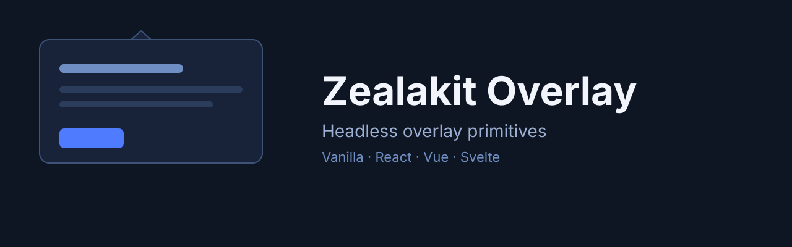

# Zealakit Overlay

[English](https://github.com/zealakit/overlay/blob/main/README.md) | [Tiếng Việt](https://github.com/zealakit/overlay/blob/main/README_VI.md) | [中文](https://github.com/zealakit/overlay/blob/main/README_CN.md)



Headless overlay primitives for building popovers, tooltips, dialogs, and context menus in Vanilla TypeScript, React, Vue, and Svelte.

- **Core** — one shared kernel for positioning, layers, focus, and the DOM controller.
- **Adapters** — React components, Vue composables, Svelte controllers and actions, and Vanilla controllers.
- **SSR-safe** — importing a package never touches browser globals.

Overlay only handles positioning, layering, dismissal, focus, and accessibility attributes. It does not ship styles, themes, or form controls.

> **Note**
> Overlay is headless: it ships no CSS and renders no styled markup. Popover, Tooltip, Dialog, and ContextMenu are implemented. Select, Combobox, DatePicker, DropdownMenu, Menubar, and command palette are not.

## Packages

| Package | Framework/Runtime | Documentation |
| --- | --- | --- |
| `@zealakit/overlay-core` | Framework-agnostic | [README](https://github.com/zealakit/overlay/blob/main/packages/core/README.md) |
| `@zealakit/overlay-vanilla` | Vanilla JS / TS | [README](https://github.com/zealakit/overlay/blob/main/packages/vanilla/README.md) |
| `@zealakit/overlay-react` | React 18 / 19 | [README](https://github.com/zealakit/overlay/blob/main/packages/react/README.md) |
| `@zealakit/overlay-vue` | Vue 3.5+ | [README](https://github.com/zealakit/overlay/blob/main/packages/vue/README.md) |
| `@zealakit/overlay-svelte` | Svelte 5 | [README](https://github.com/zealakit/overlay/blob/main/packages/svelte/README.md) |

Each package installs independently. Adapters pull in `@zealakit/overlay-core` automatically, and no runtime is shared between adapters.

## Installation

```bash
npm i @zealakit/overlay-core
npm i @zealakit/overlay-vanilla
npm i @zealakit/overlay-react react react-dom
npm i @zealakit/overlay-vue vue
npm i @zealakit/overlay-svelte svelte
```

## Examples

The [`examples/`](https://github.com/zealakit/overlay/blob/main/examples) folder holds runnable integration projects for Vanilla, React, Vue, Svelte, Next.js, and Astro. They import the compiled workspace packages, so build first.

```bash
pnpm install
pnpm build
pnpm dev:vanilla   # or dev:react, dev:vue, dev:svelte, dev:nextjs, dev:astro
```

## Dependency monitor

A local dashboard lists outdated dependencies. Run the command and open the URL. Files live in [`monitor/`](https://github.com/zealakit/overlay/blob/main/monitor).

```bash
pnpm monitor   # http://127.0.0.1:4177
```

## AI Agent Skills

- [overlay](https://github.com/zealakit/overlay/blob/main/.agents/skills/overlay/SKILL.md) — architecture, boundaries, workflow.
- [readme-system](https://github.com/zealakit/overlay/blob/main/.agents/skills/readme-system/SKILL.md) — structure of every README.
- [AGENTS.md](https://github.com/zealakit/overlay/blob/main/.agents/AGENTS.md) — hard rules and commands.

## License

MIT © Zealakit
