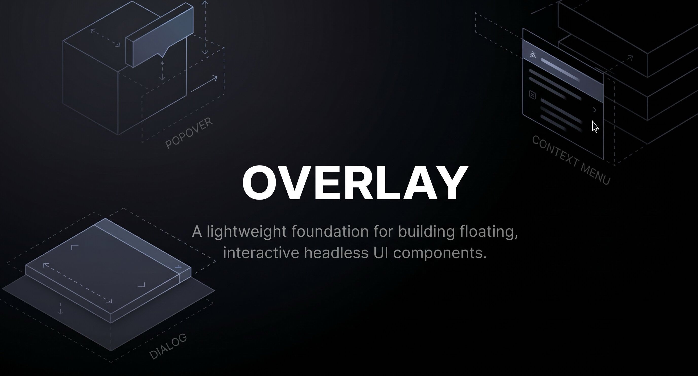

# @zealakit/overlay-react

[English](https://github.com/zealakit/overlay/blob/main/packages/react/README.md) | [Tiếng Việt](https://github.com/zealakit/overlay/blob/main/packages/react/README_VI.md) | [中文](https://github.com/zealakit/overlay/blob/main/packages/react/README_CN.md)



Headless Popover, Tooltip, Dialog, and ContextMenu for React. Provides compound components, positioning, layered dismissal, focus management, and low-level hooks. You own visual styling.

Style the parts through `className`, `style`, and the `data-*` hooks below. Closed content is unmounted (or kept with `keepMounted`), so exit animations need the `animation` prop to collapse cleanly.

> **Note**
> Overlay is headless: it ships no CSS and renders no styled markup. Popover, Tooltip, Dialog, and ContextMenu are implemented. Select, Combobox, DatePicker, DropdownMenu, Menubar, and command palette are not.

## Install

```bash
npm install @zealakit/overlay-react react react-dom
```

Peer dependencies: `react` and `react-dom` `^18.0.0 || ^19.0.0`. ESM only. Entries carry `"use client"` for Next.js App Router.

## Popover

### Quick start

```tsx
import {
  Popover,
  PopoverClose,
  PopoverContent,
  PopoverDescription,
  PopoverHeader,
  PopoverTitle,
  PopoverTrigger,
} from "@zealakit/overlay-react";

export function EditProfile() {
  return (
    <Popover>
      <PopoverTrigger>Edit profile</PopoverTrigger>
      <PopoverContent side="bottom" align="start" sideOffset={8}>
        <PopoverHeader>
          <PopoverTitle>Edit profile</PopoverTitle>
          <PopoverDescription>Update your profile information.</PopoverDescription>
        </PopoverHeader>
        <PopoverClose>Close</PopoverClose>
      </PopoverContent>
    </Popover>
  );
}
```

### `Popover` props

| Prop | Type | Default | Description |
| --- | --- | --- | --- |
| `open` | `boolean` | — | Controlled visibility. |
| `defaultOpen` | `boolean` | `false` | Initial visibility when uncontrolled. |
| `onOpenChange` | `(open: boolean, reason) => void` | — | `reason` is `trigger`, `outside-press`, `escape`, `close-button`, or `programmatic`. |
| `dismissOnEscape` | `boolean` | `true` | Close on Escape. |
| `dismissOnOutsidePress` | `boolean` | `true` | Close on a primary press outside. |
| `dir` | `"ltr" \| "rtl"` | `"ltr"` | Direction for start/end alignment. |
| `parentLayer` | `LayerStackHandle \| null` | — | Parent layer when nested in a custom layer. |
| `children` | `ReactNode` | — | `Popover` renders no element, so no other props are forwarded. |

The root owns state and the generated ids. Nested Popovers inherit the parent layer, so Escape closes the child first.

### `PopoverTrigger` props

| Prop | Type | Default | Description |
| --- | --- | --- | --- |
| `asChild` | `boolean` | `false` | Merge trigger behavior onto the single child instead of wrapping it. |
| `...button props` | `ComponentPropsWithoutRef<"button">` | — | Forwarded to the native `button`. Sets `aria-expanded` and, while open, `aria-controls`. |

Your `onClick` runs first; calling `event.preventDefault()` suppresses the toggle. A disabled trigger does not open.

### `PopoverContent` props

| Prop | Type | Default | Description |
| --- | --- | --- | --- |
| `anchor` | `Element \| null` | trigger | Explicit reference element. |
| `side` | `"top" \| "right" \| "bottom" \| "left"` | `"bottom"` | Physical side of the anchor. |
| `align` | `"start" \| "center" \| "end"` | `"center"` | Follows `dir` for top and bottom sides. |
| `sideOffset` | `number` | `0` | Main-axis gap in pixels. |
| `alignOffset` | `number` | `0` | Cross-axis offset in pixels. |
| `collisionBoundary` | `Element \| "clippingAncestors" \| "viewport"` | `"clippingAncestors"` | Collision boundary. |
| `collisionPadding` | `number` | `0` | Gap from the boundary. |
| `collisionAvoidance` | `{ flip?: boolean; shift?: boolean }` | `{ flip: true, shift: true }` | Toggle flip and shift independently. |
| `positionMethod` | `"absolute" \| "fixed"` | automatic | Automatic: `absolute`, or `fixed` for fixed/sticky anchors. |
| `arrow` | `boolean` | `false` | Render a default arrow part. |
| `arrowSize` | `number` | `8` | Arrow edge length in pixels. |
| `arrowPadding` | `number` | `0` | Gap between the arrow and the popup edges. |
| `arrowClassName` / `arrowStyle` | `string` / `CSSProperties` | — | Class and inline style for the default arrow. |
| `initialFocus` | `boolean` | `false` | Focus the first focusable element on open. |
| `trapFocus` | `boolean` | `false` | Contain focus while this layer is topmost. |
| `restoreFocus` | `boolean` | `true` | Return focus to the trigger when closing from inside. |
| `animation` | `boolean \| AnimationConfig` | — | Off unless `true` or a config is passed. |
| `portal` | `boolean \| Element \| null` | `true` | `true` portals to `document.body`, an element selects a container, `false` renders in place. |
| `...div props` | `HTMLAttributes<HTMLDivElement>` | — | Forwarded to the popup `div`; positioning props are consumed and never reach the DOM. |

No `role`, `aria-modal`, or focus trap is added by default; choose the role that fits your content. `PopoverTitle` and `PopoverDescription` wire `aria-labelledby` and `aria-describedby`. `PopoverPortal`, `PopoverPositioner`, and `PopoverPopup` are exported for advanced composition.

### Controlled usage

```tsx
const [open, setOpen] = useState(false);

<Popover open={open} onOpenChange={(next, reason) => setOpen(next)}>
  <PopoverTrigger>Edit profile</PopoverTrigger>
  <PopoverContent>Update your profile information.</PopoverContent>
</Popover>;
```

### Arrow and animation configuration

```tsx
<PopoverContent
  arrow
  arrowSize={10}
  animation={{ type: "expand", duration: 220 }}
  className="panel"
>
  Update your profile information.
</PopoverContent>
```

| Prop | Type | Default | Description |
| --- | --- | --- | --- |
| `enabled` | `boolean` | `true` with a config | Set `false` to turn the animation off. |
| `type` | `"fade" \| "expand" \| "custom"` | `"fade"` | `expand` grows out of the anchor edge; `custom` is inferred when `custom` is set. |
| `direction` | `"up" \| "down" \| "left" \| "right" \| "auto"` | `"auto"` | Travel direction; `auto` follows the resolved placement. |
| `duration` | `number` | `160` | Milliseconds. |
| `delay` | `number` | `0` | Milliseconds. |
| `easing` | `string` | `"ease-in-out"` | `ease-in-out`, `linear`, or any CSS timing function. |
| `custom` | `{ enter, exit } \| keyframes` | — | CSS classes or Web Animations keyframes (array or function). |
| `...` | — | — | Pass `true` for the defaults. Exit replays enter in reverse; reduced motion keeps only opacity. |

```css
.panel {
  --overlay-arrow-background: #121a27;
  --overlay-arrow-border-width: 1px;
  --overlay-arrow-border-color: #3d5478;
}
```

### `asChild`

```tsx
<PopoverTrigger asChild>
  <MyButton>Edit profile</MyButton>
</PopoverTrigger>
```

`asChild` clones exactly one child and keeps your refs and handlers. Custom components must forward refs so the popup can position against them.

## Tooltip

### Quick start

```tsx
import {
  Tooltip,
  TooltipContent,
  TooltipProvider,
  TooltipTrigger,
} from "@zealakit/overlay-react";

export function SaveButton() {
  return (
    <TooltipProvider delay={500}>
      <Tooltip>
        <TooltipTrigger>Edit profile</TooltipTrigger>
        <TooltipContent side="top">Update your profile information.</TooltipContent>
      </Tooltip>
    </TooltipProvider>
  );
}
```

### `TooltipProvider` props

| Prop | Type | Default | Description |
| --- | --- | --- | --- |
| `delay` | `number` | `500` | Hover opening delay in milliseconds. |
| `closeDelay` | `number` | `100` | Delay before closing after pointer or focus leaves. |
| `skipDelayDuration` | `number` | `300` | Window after opening where the next Tooltip opens immediately. |
| `disableHoverableContent` | `boolean` | `false` | Close when leaving the trigger even if the pointer enters the content. |
| `children` | `ReactNode` | — | The provider renders no element. It is optional; a Tooltip without one uses the defaults. |

### `Tooltip` props

| Prop | Type | Default | Description |
| --- | --- | --- | --- |
| `open` | `boolean` | — | Controlled visibility. |
| `defaultOpen` | `boolean` | `false` | Initial visibility when uncontrolled. |
| `onOpenChange` | `(open: boolean, reason) => void` | — | `reason` is `hover`, `focus`, `escape`, `outside-press`, `trigger`, or `programmatic`. |
| `disabled` | `boolean` | `false` | Never opens. |
| `delay` / `closeDelay` / `disableHoverableContent` | — | provider value | Override the provider for this Tooltip. |
| `dir` | `"ltr" \| "rtl"` | `"ltr"` | Direction for start/end alignment. |
| `children` | `ReactNode` | — | `Tooltip` renders no element, so no other props are forwarded. |

Hover opens after `delay`, focus opens immediately, and Escape or an outside press closes. Touch hover is ignored. A Tooltip registers no layer, so it never blocks a parent Popover or Dialog.

### `TooltipTrigger` props

| Prop | Type | Default | Description |
| --- | --- | --- | --- |
| `asChild` | `boolean` | `false` | Merge trigger behavior onto the single child. |
| `...button props` | `ComponentPropsWithoutRef<"button">` | — | Forwarded to the native `button`. While open it gets `aria-describedby`; clicking closes but never opens. |

### `TooltipContent` props

| Prop | Type | Default | Description |
| --- | --- | --- | --- |
| `anchor` | `Element \| null` | trigger | Explicit reference element. |
| `side` | `"top" \| "right" \| "bottom" \| "left"` | `"bottom"` | Physical side of the anchor. |
| `align` | `"start" \| "center" \| "end"` | `"center"` | Follows `dir` for top and bottom sides. |
| `sideOffset` | `number` | `0` | Main-axis gap in pixels. |
| `alignOffset` | `number` | `0` | Cross-axis offset in pixels. |
| `collisionBoundary` | `Element \| "clippingAncestors" \| "viewport"` | `"clippingAncestors"` | Collision boundary. |
| `collisionPadding` | `number` | `0` | Gap from the boundary. |
| `collisionAvoidance` | `{ flip?: boolean; shift?: boolean }` | `{ flip: true, shift: true }` | Toggle flip and shift independently. |
| `positionMethod` | `"absolute" \| "fixed"` | automatic | Automatic: `absolute`, or `fixed` for fixed/sticky anchors. |
| `arrow` | `boolean` | `false` | Render a default arrow part. |
| `arrowSize` | `number` | `8` | Arrow edge length in pixels. |
| `arrowPadding` | `number` | `0` | Gap between the arrow and the popup edges. |
| `arrowClassName` / `arrowStyle` | `string` / `CSSProperties` | — | Class and inline style for the default arrow. |
| `animation` | `boolean \| AnimationConfig` | — | Off unless `true` or a config is passed. |
| `portal` | `boolean \| Element \| null` | `true` | `true` portals to `document.body`, an element selects a container, `false` renders in place. |
| `...div props` | `HTMLAttributes<HTMLDivElement>` | — | Forwarded to the popup `div` with `role="tooltip"`. The popup is not focusable. |

### Controlled usage

```tsx
const [open, setOpen] = useState(false);

<Tooltip open={open} onOpenChange={(next, reason) => setOpen(next)}>
  <TooltipTrigger>Edit profile</TooltipTrigger>
  <TooltipContent>Update your profile information.</TooltipContent>
</Tooltip>;
```

### Arrow and animation configuration

```tsx
<TooltipContent arrow arrowSize={6} animation={{ duration: 120 }}>
  Update your profile information.
</TooltipContent>
```

Options are the same as [Popover](https://github.com/zealakit/overlay/blob/main/packages/react/README.md#arrow-and-animation-configuration).

### Disabled triggers

```tsx
<Tooltip>
  <TooltipTrigger asChild>
    <span tabIndex={0}>
      <button type="button" disabled>Edit profile</button>
    </span>
  </TooltipTrigger>
  <TooltipContent>Editing is unavailable.</TooltipContent>
</Tooltip>
```

A native disabled button cannot take focus, so wrap it in a focusable element. Use Popover instead when the content is interactive.

## Dialog

### Quick start

```tsx
import {
  Dialog,
  DialogClose,
  DialogContent,
  DialogDescription,
  DialogFooter,
  DialogHeader,
  DialogTitle,
  DialogTrigger,
} from "@zealakit/overlay-react";

export function EditProfile() {
  return (
    <Dialog>
      <DialogTrigger>Edit profile</DialogTrigger>
      <DialogContent>
        <DialogHeader>
          <DialogTitle>Edit profile</DialogTitle>
          <DialogDescription>Update your profile information.</DialogDescription>
        </DialogHeader>
        <DialogFooter>
          <DialogClose>Cancel</DialogClose>
          <button type="submit">Save</button>
        </DialogFooter>
      </DialogContent>
    </Dialog>
  );
}
```

### `Dialog` props

| Prop | Type | Default | Description |
| --- | --- | --- | --- |
| `open` | `boolean` | — | Controlled visibility. |
| `defaultOpen` | `boolean` | `false` | Initial visibility when uncontrolled. |
| `onOpenChange` | `(open: boolean, reason) => void` | — | `reason` is `trigger`, `outside-press`, `escape`, `close-button`, or `programmatic`. |
| `modal` | `boolean` | `true` | Modal: `aria-modal`, focus containment, inert background, scroll lock. |
| `lockScroll` | `boolean` | `modal` | Lock document scrolling while open. |
| `dismissOnEscape` | `boolean` | `true` | Close on Escape. |
| `dismissOnOutsidePress` | `boolean` | `true` | Close on a backdrop or outside press. |
| `dir` | `"ltr" \| "rtl"` | `"ltr"` | Direction passed to the popup. |
| `parentLayer` | `LayerStackHandle \| null` | — | Parent layer when nested in a custom layer. |
| `children` | `ReactNode` | — | `Dialog` renders no element, so no other props are forwarded. |

### `DialogTrigger` props

| Prop | Type | Default | Description |
| --- | --- | --- | --- |
| `asChild` | `boolean` | `false` | Merge trigger behavior onto the single child. |
| `...button props` | `ComponentPropsWithoutRef<"button">` | — | Forwarded to the native `button`. Sets `aria-haspopup="dialog"`, `aria-expanded`, and `aria-controls`. |

### `DialogContent` props

| Prop | Type | Default | Description |
| --- | --- | --- | --- |
| `backdrop` | `boolean` | `modal` | Render the structural backdrop. |
| `initialFocus` | `"container" \| "first" \| Element \| (() => Element \| null) \| null` | `"container"` when modal | Where focus lands on open; `null` keeps focus in place. |
| `finalFocus` | `Element \| (() => Element \| null) \| null` | — | Where focus returns on close; defaults to the trigger. |
| `restoreFocus` | `boolean` | `true` | Restore focus on close. |
| `keepMounted` | `boolean` | `false` | Keep closed content in the DOM as `hidden` for consumer transitions. |
| `animation` | `boolean \| AnimationConfig` | — | Off unless `true` or a config is passed. |
| `portal` | `boolean \| Element \| null` | `true` | `true` portals to `document.body`, an element selects a container, `false` renders in place. |
| `...div props` | `HTMLAttributes<HTMLDivElement>` | — | Forwarded to the popup `div` with `role="dialog"`. |

Add a `DialogTitle` or an `aria-label`; the dialog has no accessible name without one. `DialogHeader`, `DialogFooter`, and `DialogClose` are layout and close helpers; no close button is injected. `DialogPortal`, `DialogBackdrop`, `DialogViewport`, and `DialogPopup` are exported for advanced composition.

### Controlled usage

```tsx
const [open, setOpen] = useState(false);

<Dialog open={open} onOpenChange={(next, reason) => setOpen(next)}>
  <DialogContent>
    <DialogTitle>Edit profile</DialogTitle>
  </DialogContent>
</Dialog>;
```

### Animation configuration

```tsx
<DialogContent animation={{ duration: 200 }}>
  <DialogTitle>Edit profile</DialogTitle>
</DialogContent>
```

Options are the same as [Popover](https://github.com/zealakit/overlay/blob/main/packages/react/README.md#arrow-and-animation-configuration). The dialog zooms from the centre and the backdrop only fades.

### `keepMounted`

Closed content unmounts by default. With `keepMounted` it stays as `hidden` with `data-state="closed"`. Focus containment and scroll lock release the moment the dialog closes, so exit transitions never leave the page modal.

## ContextMenu

### Quick start

```tsx
import {
  ContextMenu,
  ContextMenuContent,
  ContextMenuItem,
  ContextMenuSeparator,
  ContextMenuTrigger,
} from "@zealakit/overlay-react";

export function ProfileCard() {
  return (
    <ContextMenu>
      <ContextMenuTrigger>Edit profile</ContextMenuTrigger>
      <ContextMenuContent>
        <ContextMenuItem onSelect={() => console.log("edit")}>Edit</ContextMenuItem>
        <ContextMenuSeparator />
        <ContextMenuItem disabled>Delete</ContextMenuItem>
      </ContextMenuContent>
    </ContextMenu>
  );
}
```

### `ContextMenu` props

| Prop | Type | Default | Description |
| --- | --- | --- | --- |
| `open` | `boolean` | — | Controlled visibility. |
| `defaultOpen` | `boolean` | `false` | Initial visibility when uncontrolled. |
| `onOpenChange` | `(open: boolean, reason) => void` | — | `reason` is `trigger`, `outside-press`, `escape`, `select`, or `programmatic`. |
| `disabled` | `boolean` | `false` | Leaves the native browser menu untouched. |
| `dir` | `"ltr" \| "rtl"` | `"ltr"` | Direction; reverses submenu side and arrow keys. |
| `parentLayer` | `LayerStackHandle \| null` | — | Parent layer when nested in a custom layer. |
| `children` | `ReactNode` | — | `ContextMenu` renders no element, so no other props are forwarded. |

### `ContextMenuTrigger` props

| Prop | Type | Default | Description |
| --- | --- | --- | --- |
| `asChild` | `boolean` | `false` | Use an existing element as the target. |
| `disabled` | `boolean` | `false` | Ignore invocation. |
| `...div props` | `ComponentPropsWithoutRef<"div">` | — | Forwarded to a focusable `div`. Right-click, the Context Menu key, and Shift+F10 open the menu. |

Pointer invocation anchors at the cursor; keyboard invocation anchors at the trigger. Give the trigger a role or label that fits your target.

### `ContextMenuContent` props

| Prop | Type | Default | Description |
| --- | --- | --- | --- |
| `side` | `"top" \| "right" \| "bottom" \| "left"` | `"bottom"` | Physical side of the anchor. |
| `align` | `"start" \| "center" \| "end"` | `"start"` | Follows `dir` for top and bottom sides. |
| `sideOffset` / `alignOffset` / `collisionPadding` | `number` | `0` | Offsets and boundary gap in pixels. |
| `collisionBoundary` / `collisionAvoidance` / `positionMethod` | — | — | Same as Popover. |
| `animation` | `boolean \| AnimationConfig` | — | Off unless `true` or a config is passed. |
| `portal` | `boolean \| Element \| null` | `true` | `true` portals to `document.body`, an element selects a container, `false` renders in place. |
| `...div props` | `HTMLAttributes<HTMLDivElement>` | — | Forwarded to the popup `div` with `role="menu"`. Arrow keys, Home, End, and typeahead move focus; the menu is not focus-trapped. |

### `ContextMenuItem` props

| Prop | Type | Default | Description |
| --- | --- | --- | --- |
| `disabled` | `boolean` | `false` | Skipped by keyboard navigation and never activates. |
| `onSelect` | `(event) => void` | — | Receives an event with `preventDefault()` and `originalEvent`. |
| `closeOnSelect` | `boolean` | `true` | Set `false` or call `event.preventDefault()` to keep the menu open. |
| `asChild` | `boolean` | `false` | Use your own element as the item. |
| `...div props` | `ComponentPropsWithoutRef<"div">` | — | Forwarded to the item `div` with `role="menuitem"`. |

### `ContextMenuCheckboxItem` / `ContextMenuRadioGroup` / `ContextMenuRadioItem` props

| Prop | Type | Default | Description |
| --- | --- | --- | --- |
| `checked` / `defaultChecked` | `boolean` | — | Checkbox item state, controlled or uncontrolled. |
| `onCheckedChange` | `(checked: boolean) => void` | — | Called when a checkbox item toggles. |
| `value` / `defaultValue` | `string` | — | `RadioGroup` selected value; `RadioItem` requires `value`. |
| `onValueChange` | `(value: string) => void` | — | Called when the radio selection changes. |
| `closeOnSelect` | `boolean` | `false` | Checkbox and radio items keep the menu open by default. |
| `...div props` | `ComponentPropsWithoutRef<"div">` | — | Forwarded with `role="menuitemcheckbox"` or `role="menuitemradio"` and `aria-checked`. |

`ContextMenuGroup`, `ContextMenuLabel`, `ContextMenuSeparator`, and `ContextMenuShortcut` are structural. Submenus use `ContextMenuSub` (`defaultOpen`, uncontrolled), `ContextMenuSubTrigger`, and `ContextMenuSubContent`, which takes the same positioning props as `ContextMenuContent` and opens to the right in LTR and left in RTL.

### Controlled usage

```tsx
const [open, setOpen] = useState(false);

<ContextMenu open={open} onOpenChange={(next, reason) => setOpen(next)}>
  <ContextMenuTrigger>Edit profile</ContextMenuTrigger>
  <ContextMenuContent>
    <ContextMenuItem>Edit</ContextMenuItem>
  </ContextMenuContent>
</ContextMenu>;
```

### Animation configuration

```tsx
<ContextMenuContent animation={{ type: "expand", duration: 160 }}>
  <ContextMenuItem>Edit</ContextMenuItem>
</ContextMenuContent>
```

Options are the same as [Popover](https://github.com/zealakit/overlay/blob/main/packages/react/README.md#arrow-and-animation-configuration). ContextMenu has no arrow.

### `onSelect`

```tsx
<ContextMenuItem
  onSelect={(event) => {
    event.preventDefault(); // keep the menu open
    console.log(event.originalEvent);
  }}
>
  Edit
</ContextMenuItem>
```

Selecting an item closes the whole menu tree. Escape and outside presses close only the topmost submenu first.

## Hooks

| Export | Purpose |
| --- | --- |
| `usePositioner(options)` | Callback refs plus the latest `PositionerResult`; accepts core positioner options and an explicit `reference`. |
| `useLayer(options)` | Register a layer while mounted: `element`, `reference`, `parent`, `boundaries`, `dismissOnEscape`, `dismissOnOutsidePress`, `onDismiss`. |
| `useOverlay(options)` | Uncontrolled open state composed from the two hooks above; returns `isOpen`, `open`, `close`, `toggle`, refs, and `floatingStyles`. |
| `useEscapeKey(handler, options?)` | Escape listener with `enabled` and `target`. |
| `Portal` | Render children into `document.body` or a container after mount; renders `null` on the server. |

```tsx
const { referenceRef, floatingRef, result } = usePositioner({
  placement: "bottom-start",
  offset: 8,
});

<button ref={referenceRef}>Edit profile</button>;
<div
  ref={floatingRef}
  style={{ position: result?.strategy ?? "fixed", left: result?.x ?? 0, top: result?.y ?? 0 }}
/>;
```

Hooks create core objects in effects, never during render, and are safe under Strict Mode. Core focus helpers (`createFocusContainment`, `focusElement`, `focusFirst`, `getFocusableElements`, `isFocusable`, `getActiveElement`, `restoreFocus`) are re-exported.

## Styling hooks

| Attribute | Where | Purpose |
| --- | --- | --- |
| `data-state` | Popup, trigger | `"open"` or `"closed"`; `"closed"` is observable with `keepMounted` or `animation`. |
| `data-open` / `data-closed` | Popup | Presence flags for CSS selectors. |
| `data-side` / `data-align` | Popup, arrow | Resolved placement after flip and shift. |
| `data-animating` | Popup | `"enter"` or `"exit"` while an animation runs. |
| `data-modal` / `data-non-modal` / `data-nested` / `data-nested-dialog-open` | Dialog popup | Mode and nesting state. |
| `data-disabled` | Menu items | Set on disabled items. |
| `--popover-anchor-width` / `--popover-anchor-height` | Popover popup | Trigger size, for matching widths. |
| `--tooltip-anchor-width` / `--tooltip-anchor-height` | Tooltip popup | Trigger size. |
| `--overlay-transform-origin` | Popup | Anchor-edge origin for class-based animation. |
| `--overlay-arrow-*` | Panel or ancestor | Arrow background, border width, and border color. |

## Next.js App Router

Every entry carries `"use client"`, so import the components from client components. Importing is safe on the server, and overlay content renders only after mount.

```tsx
"use client";

import { Popover, PopoverContent, PopoverTrigger } from "@zealakit/overlay-react";
```

## AI Agent Skill

Coding agents working on this package load the [overlay skill](https://github.com/zealakit/overlay/blob/main/.agents/skills/overlay/SKILL.md) first.

## License

MIT © Zealakit
