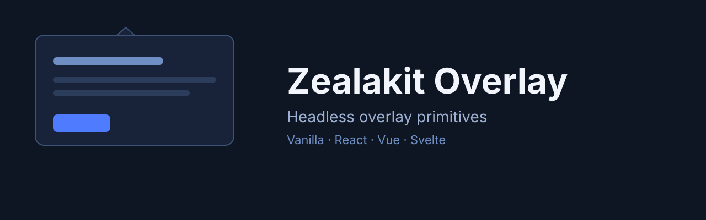

# @zealakit/overlay-svelte

[English](https://github.com/zealakit/overlay/blob/main/packages/svelte/README.md) | [Tiếng Việt](https://github.com/zealakit/overlay/blob/main/packages/svelte/README_VI.md) | [中文](https://github.com/zealakit/overlay/blob/main/packages/svelte/README_CN.md)



面向 Svelte 5 的无样式 Popover、Tooltip、Dialog 和 ContextMenu 组件。提供复合组件、定位、分层关闭、焦点管理，以及底层控制器和 action。视觉样式由你自己决定。

请通过 `class`、`style` 和下方的 `data-*` 钩子为各部分设置样式。关闭时内容以 `hidden` 保留在 DOM 中，且 `hidden` 由控制器管理，因此不要自行绑定；启用 `animation` 时内容会保持可见，直到退出动画结束。

> **Note**
> Overlay 是无样式（headless）的：不附带 CSS，也不渲染带样式的标记。已实现 Popover、Tooltip、Dialog 和 ContextMenu；尚未实现 Select、Combobox、DatePicker、DropdownMenu、Menubar 和命令面板。

## Install

```bash
npm install @zealakit/overlay-svelte svelte
```

Peer 依赖：`svelte` `^5.0.0`。仅支持 Svelte 5；仅支持 ESM。组件以 `.svelte` 文件形式从 `@zealakit/overlay-svelte/components` 提供，因此请使用带 `@sveltejs/vite-plugin-svelte` 的 Vite（SvelteKit 已包含）。根入口仍是纯 JavaScript。

## Popover

### Quick start

```svelte
<script lang="ts">
  import {
    Popover,
    PopoverClose,
    PopoverContent,
    PopoverDescription,
    PopoverHeader,
    PopoverTitle,
    PopoverTrigger,
  } from "@zealakit/overlay-svelte/components";
</script>

<Popover placement="bottom-start" offset={8}>
  <PopoverTrigger>Edit profile</PopoverTrigger>
  <PopoverContent>
    <PopoverHeader>
      <PopoverTitle>Edit profile</PopoverTitle>
      <PopoverDescription>Update your profile information.</PopoverDescription>
    </PopoverHeader>
    <PopoverClose>Close</PopoverClose>
  </PopoverContent>
</Popover>
```

### `Popover` props

| Prop | Type | Default | Description |
| --- | --- | --- | --- |
| `open` | `boolean` | — | 受控可见性。使用 `bind:open`。 |
| `defaultOpen` | `boolean` | `false` | 非受控时的初始可见性。 |
| `disabled` | `boolean` | `false` | 关闭 overlay 并忽略 trigger。 |
| `placement` | `Placement` | `"bottom-start"`（Tooltip 为 `"top"`） | 边加可选的 `-start` 或 `-end`。 |
| `offset` / `alignOffset` | `number` | `0` | 主轴间距与交叉轴偏移（像素）。 |
| `flip` / `shift` / `autoUpdate` | `boolean` | `true` | 碰撞处理，以及滚动和缩放时重新定位。 |
| `padding` | `number` | `0` | 与碰撞边界的间距。 |
| `boundary` | `Element \| "clippingAncestors" \| "viewport"` | `"clippingAncestors"` | 碰撞边界。 |
| `strategy` | `"absolute" \| "fixed"` | automatic | 自动：`absolute`，固定/粘性锚点用 `fixed`。 |
| `dir` | `"ltr" \| "rtl"` | — | 应用到 content 元素。 |
| `dismissOnEscape` / `dismissOnOutsidePress` | `boolean` | `true` | 按 Escape 或在外部主键按下时关闭。 |
| `portal` | `boolean \| HTMLElement` | `true` | `true` 渲染到 `document.body`，传入元素则选择容器，`false` 就地渲染。 |
| `animation` | `boolean \| AnimationConfig` | — | 除非传入 `true` 或配置，否则关闭。 |
| `arrow` | `boolean` | `false` | 定位箭头部分。请在 content 内渲染箭头组件。 |
| `arrowSize` / `arrowPadding` | `number` | `8` / `0` | 箭头边长以及与弹层边缘的间距（像素）。 |
| `trapFocus` | `boolean` | `false` | 该 layer 位于最上层时约束焦点。 |
| `initialFocus` | `boolean \| "container" \| "first" \| Element \| null` | — | 打开时焦点落点；默认不聚焦。 |
| `restoreFocus` | `boolean` | `true` | 从内部关闭时把焦点还给 trigger。 |
| `onOpenChange` / `children` | `(open, reason) => void` / `Snippet` | — | 每次变化时调用；`reason` 为 `trigger`、`escape-key`、`outside-press`、`reference-press`、`select` 或 `programmatic`。children snippet 接收 `{ open }`；不转发其他属性。 |

根组件不渲染元素。它持有状态并与其各部分共享，因此在根组件之外使用某个部分会抛出清晰的错误。

### `PopoverTrigger` props

| Prop | Type | Default | Description |
| --- | --- | --- | --- |
| `as` | `string` | `"button"` | 要渲染的标签。请使用可聚焦元素。 |
| `...attrs` | `HTMLAttributes` | — | 转发给该元素。设置 `type="button"`、`aria-expanded`，打开时设置 `aria-controls`。 |

### `PopoverContent` props

| Prop | Type | Default | Description |
| --- | --- | --- | --- |
| `as` | `string` | `"div"` | 要渲染的标签。 |
| `...attrs` | `HTMLAttributes` | — | 转发给 content `div`。不会添加 `role` 或焦点陷阱；`PopoverTitle` 与 `PopoverDescription` 会连接 `aria-labelledby` 和 `aria-describedby`。 |

`PopoverHeader`、`PopoverTitle`、`PopoverDescription`、`PopoverClose` 和 `PopoverArrow` 接受 `as` 并转发其余属性。`PopoverClose` 会关闭 popover。

### Controlled usage

```svelte
<script lang="ts">
  let open = $state(false);
</script>

<Popover bind:open onOpenChange={(next, reason) => console.log(next, reason)}>
  <PopoverTrigger>Edit profile</PopoverTrigger>
  <PopoverContent>Update your profile information.</PopoverContent>
</Popover>
```

### Animation configuration

```svelte
<Popover arrow arrowSize={10} animation={{ type: "expand", duration: 220 }}>
  <PopoverTrigger>Edit profile</PopoverTrigger>
  <PopoverContent>
    Update your profile information.
    <PopoverArrow />
  </PopoverContent>
</Popover>
```

| Prop | Type | Default | Description |
| --- | --- | --- | --- |
| `enabled` | `boolean` | `true` with a config | 设为 `false` 可关闭动画。 |
| `type` | `"fade" \| "expand" \| "custom"` | `"fade"` | `expand` 从锚点边缘展开；设置 `custom` 时自动推断为 `custom`。 |
| `direction` | `"up" \| "down" \| "left" \| "right" \| "auto"` | `"auto"` | 移动方向；`auto` 跟随最终 placement。 |
| `duration` | `number` | `160` | 毫秒。 |
| `delay` | `number` | `0` | 毫秒。 |
| `easing` | `string` | `"ease-in-out"` | `ease-in-out`、`linear` 或任意 CSS timing function。 |
| `custom` | `{ enter, exit } \| keyframes` | — | CSS class 或 Web Animations keyframes（数组或函数）。 |
| `...` | — | — | 传入 `true` 使用默认值。退出动画反向播放进入动画；减少动态效果时仅保留 opacity。 |

```css
.panel {
  --overlay-arrow-background: #121a27;
  --overlay-arrow-border-width: 1px;
  --overlay-arrow-border-color: #3d5478;
}
```

### `as`

每个部分都会渲染合适的默认标签。传入 `as` 可更改，例如用 `as="span"` 把禁用的按钮包在可聚焦元素中。该部分仍保留其 id、ARIA 属性和 ref。

## Tooltip

### Quick start

```svelte
<script lang="ts">
  import {
    Tooltip,
    TooltipContent,
    TooltipTrigger,
  } from "@zealakit/overlay-svelte/components";
</script>

<Tooltip placement="top" delay={500}>
  <TooltipTrigger>Edit profile</TooltipTrigger>
  <TooltipContent>Update your profile information.</TooltipContent>
</Tooltip>
```

### `Tooltip` props

| Prop | Type | Default | Description |
| --- | --- | --- | --- |
| `open` | `boolean` | — | 受控可见性。使用 `bind:open`。 |
| `defaultOpen` | `boolean` | `false` | 非受控时的初始可见性。 |
| `disabled` | `boolean` | `false` | 关闭 overlay 并忽略 trigger。 |
| `placement` | `Placement` | `"bottom-start"`（Tooltip 为 `"top"`） | 边加可选的 `-start` 或 `-end`。 |
| `offset` / `alignOffset` | `number` | `0` | 主轴间距与交叉轴偏移（像素）。 |
| `flip` / `shift` / `autoUpdate` | `boolean` | `true` | 碰撞处理，以及滚动和缩放时重新定位。 |
| `padding` | `number` | `0` | 与碰撞边界的间距。 |
| `boundary` | `Element \| "clippingAncestors" \| "viewport"` | `"clippingAncestors"` | 碰撞边界。 |
| `strategy` | `"absolute" \| "fixed"` | automatic | 自动：`absolute`，固定/粘性锚点用 `fixed`。 |
| `dir` | `"ltr" \| "rtl"` | — | 应用到 content 元素。 |
| `dismissOnEscape` / `dismissOnOutsidePress` | `boolean` | `true` | 按 Escape 或在外部主键按下时关闭。 |
| `portal` | `boolean \| HTMLElement` | `true` | `true` 渲染到 `document.body`，传入元素则选择容器，`false` 就地渲染。 |
| `animation` | `boolean \| AnimationConfig` | — | 除非传入 `true` 或配置，否则关闭。 |
| `arrow` | `boolean` | `false` | 定位箭头部分。请在 content 内渲染箭头组件。 |
| `arrowSize` / `arrowPadding` | `number` | `8` / `0` | 箭头边长以及与弹层边缘的间距（像素）。 |
| `delay` | `number` | `500` | 悬停打开延迟（毫秒）。 |
| `closeDelay` | `number` | `100` | 指针或焦点离开后关闭前的延迟。 |
| `hoverableContent` | `boolean` | `true` | 指针在内容上时保持打开。 |
| `onOpenChange` / `children` | `(open, reason) => void` / `Snippet` | — | 每次变化时调用；`reason` 为 `trigger`、`escape-key`、`outside-press`、`reference-press`、`select` 或 `programmatic`。children snippet 接收 `{ open }`；不转发其他属性。 |

根组件不渲染元素。它持有状态并与其各部分共享，因此在根组件之外使用某个部分会抛出清晰的错误。

### `TooltipTrigger` props

| Prop | Type | Default | Description |
| --- | --- | --- | --- |
| `as` | `string` | `"button"` | 要渲染的标签。请使用可聚焦元素。 |
| `...attrs` | `HTMLAttributes` | — | 转发给该元素。打开时带有 `aria-describedby`；点击只会关闭，不会打开。 |

### `TooltipContent` props

| Prop | Type | Default | Description |
| --- | --- | --- | --- |
| `as` | `string` | `"div"` | 要渲染的标签。 |
| `...attrs` | `HTMLAttributes` | — | 转发给带 `role="tooltip"` 的 content `div`。内容不可聚焦。 |

悬停在 `delay` 后打开，聚焦立即打开，Escape 或外部点击关闭。触摸悬停会被忽略。`TooltipArrow` 接受 `as` 并转发其余属性。

### Controlled usage

```svelte
<script lang="ts">
  let open = $state(false);
</script>

<Tooltip bind:open onOpenChange={(next, reason) => console.log(next, reason)}>
  <TooltipTrigger>Edit profile</TooltipTrigger>
  <TooltipContent>Update your profile information.</TooltipContent>
</Tooltip>
```

### Animation configuration

`Tooltip` 接受与 Popover 相同的 `animation` 选项：传入 `true` 或类似 `{ duration: 160 }` 的配置。参见 [Popover 选项](https://github.com/zealakit/overlay/blob/main/packages/svelte/README_CN.md#popover)。

### `as`

每个部分都会渲染合适的默认标签。传入 `as` 可更改，例如用 `as="span"` 把禁用的按钮包在可聚焦元素中。该部分仍保留其 id、ARIA 属性和 ref。

## Dialog

### Quick start

```svelte
<script lang="ts">
  import {
    Dialog,
    DialogBackdrop,
    DialogClose,
    DialogContent,
    DialogDescription,
    DialogTitle,
    DialogTrigger,
  } from "@zealakit/overlay-svelte/components";
</script>

<Dialog>
  <DialogTrigger>Edit profile</DialogTrigger>
  <DialogBackdrop>
    <div data-dialog-backdrop></div>
    <div data-dialog-viewport>
      <DialogContent>
        <DialogTitle>Edit profile</DialogTitle>
        <DialogDescription>Update your profile information.</DialogDescription>
        <DialogClose>Cancel</DialogClose>
      </DialogContent>
    </div>
  </DialogBackdrop>
</Dialog>
```

### `Dialog` props

| Prop | Type | Default | Description |
| --- | --- | --- | --- |
| `open` | `boolean` | — | 受控可见性。使用 `bind:open`。 |
| `defaultOpen` | `boolean` | `false` | 非受控时的初始可见性。 |
| `disabled` | `boolean` | `false` | 关闭 overlay 并忽略 trigger。 |
| `placement` | `Placement` | — | 对话框不锚定。 |
| `dir` | `"ltr" \| "rtl"` | — | 应用到 content 元素。 |
| `dismissOnEscape` / `dismissOnOutsidePress` | `boolean` | `true` | 按 Escape 或在外部主键按下时关闭。 |
| `portal` | `boolean \| HTMLElement` | `true` | `true` 渲染到 `document.body`，传入元素则选择容器，`false` 就地渲染。 |
| `animation` | `boolean \| AnimationConfig` | — | 除非传入 `true` 或配置，否则关闭。 |
| `modal` | `boolean` | `true` | 模态：`aria-modal`、焦点约束、背景 inert、滚动锁。 |
| `lockScroll` | `boolean` | `modal` | 打开时锁定文档滚动。 |
| `trapFocus` | `boolean` | `modal` | 该 layer 位于最上层时约束焦点。 |
| `initialFocus` | `boolean \| "container" \| "first" \| Element \| null` | 模态时为 `"container"` | 打开时焦点落点；`null` 保持焦点不动。 |
| `restoreFocus` | `boolean` | `true` | 关闭时恢复焦点。 |
| `onOpenChange` / `children` | `(open, reason) => void` / `Snippet` | — | 每次变化时调用；`reason` 为 `trigger`、`escape-key`、`outside-press`、`reference-press`、`select` 或 `programmatic`。children snippet 接收 `{ open }`；不转发其他属性。 |

根组件不渲染元素。它持有状态并与其各部分共享，因此在根组件之外使用某个部分会抛出清晰的错误。

### `DialogTrigger` props

| Prop | Type | Default | Description |
| --- | --- | --- | --- |
| `as` | `string` | `"button"` | 要渲染的标签。请使用可聚焦元素。 |
| `...attrs` | `HTMLAttributes` | — | 转发给该元素。设置 `aria-haspopup="dialog"`、`aria-expanded` 和 `aria-controls`。 |

### `DialogContent` props

| Prop | Type | Default | Description |
| --- | --- | --- | --- |
| `as` | `string` | `"div"` | 要渲染的标签。 |
| `...attrs` | `HTMLAttributes` | — | 转发给带 `role="dialog"` 的 content `div`。请添加 `DialogTitle` 或 `aria-label` 以提供可访问名称。 |

`DialogBackdrop` 包裹 viewport 与 content，因此 backdrop、viewport 和 content 作为一个整体进行 portal 与切换。`DialogHeader` 与 `DialogFooter` 是布局包装；`DialogTitle` 与 `DialogDescription` 连接 `aria-labelledby` 和 `aria-describedby`；`DialogClose` 会关闭对话框。它们都接受 `as`。

### Controlled usage

```svelte
<script lang="ts">
  let open = $state(false);
</script>

<Dialog bind:open onOpenChange={(next, reason) => console.log(next, reason)}>
  <DialogTrigger>Edit profile</DialogTrigger>
  <DialogContent>Update your profile information.</DialogContent>
</Dialog>
```

### Animation configuration

`Dialog` 接受与 Popover 相同的 `animation` 选项：传入 `true` 或类似 `{ duration: 160 }` 的配置。参见 [Popover 选项](https://github.com/zealakit/overlay/blob/main/packages/svelte/README_CN.md#popover)。

### `as`

每个部分都会渲染合适的默认标签。传入 `as` 可更改，例如用 `as="span"` 把禁用的按钮包在可聚焦元素中。该部分仍保留其 id、ARIA 属性和 ref。

## ContextMenu

### Quick start

```svelte
<script lang="ts">
  import {
    ContextMenu,
    ContextMenuContent,
    ContextMenuItem,
    ContextMenuSeparator,
    ContextMenuTrigger,
  } from "@zealakit/overlay-svelte/components";
</script>

<ContextMenu>
  <ContextMenuTrigger>Edit profile</ContextMenuTrigger>
  <ContextMenuContent>
    <ContextMenuItem onselect={() => console.log("edit")}>Edit</ContextMenuItem>
    <ContextMenuSeparator />
    <ContextMenuItem disabled>Delete</ContextMenuItem>
  </ContextMenuContent>
</ContextMenu>
```

### `ContextMenu` props

| Prop | Type | Default | Description |
| --- | --- | --- | --- |
| `open` | `boolean` | — | 受控可见性。使用 `bind:open`。 |
| `defaultOpen` | `boolean` | `false` | 非受控时的初始可见性。 |
| `disabled` | `boolean` | `false` | 关闭 overlay 并忽略 trigger。 |
| `placement` | `Placement` | `"bottom-start"`（Tooltip 为 `"top"`） | 边加可选的 `-start` 或 `-end`。 |
| `offset` / `alignOffset` | `number` | `0` | 主轴间距与交叉轴偏移（像素）。 |
| `flip` / `shift` / `autoUpdate` | `boolean` | `true` | 碰撞处理，以及滚动和缩放时重新定位。 |
| `padding` | `number` | `0` | 与碰撞边界的间距。 |
| `boundary` | `Element \| "clippingAncestors" \| "viewport"` | `"clippingAncestors"` | 碰撞边界。 |
| `strategy` | `"absolute" \| "fixed"` | automatic | 自动：`absolute`，固定/粘性锚点用 `fixed`。 |
| `dir` | `"ltr" \| "rtl"` | — | 应用到 content 元素。 |
| `dismissOnEscape` / `dismissOnOutsidePress` | `boolean` | `true` | 按 Escape 或在外部主键按下时关闭。 |
| `portal` | `boolean \| HTMLElement` | `true` | `true` 渲染到 `document.body`，传入元素则选择容器，`false` 就地渲染。 |
| `animation` | `boolean \| AnimationConfig` | — | 除非传入 `true` 或配置，否则关闭。 |
| `onOpenChange` / `children` | `(open, reason) => void` / `Snippet` | — | 每次变化时调用；`reason` 为 `trigger`、`escape-key`、`outside-press`、`reference-press`、`select` 或 `programmatic`。children snippet 接收 `{ open }`；不转发其他属性。 |

根组件不渲染元素。它持有状态并与其各部分共享，因此在根组件之外使用某个部分会抛出清晰的错误。

### `ContextMenuTrigger` props

| Prop | Type | Default | Description |
| --- | --- | --- | --- |
| `as` | `string` | `"div"` | 要渲染的标签。请使用可聚焦元素。 |
| `...attrs` | `HTMLAttributes` | — | 转发给该元素。设置 `tabindex="0"`；右键、Context Menu 键和 Shift+F10 会打开菜单。 |

### `ContextMenuContent` props

| Prop | Type | Default | Description |
| --- | --- | --- | --- |
| `as` | `string` | `"div"` | 要渲染的标签。 |
| `...attrs` | `HTMLAttributes` | — | 转发给带 `role="menu"` 的 content `div`。方向键、Home、End 和 typeahead 用于移动焦点；菜单不会陷住焦点。 |

### `ContextMenuItem` props

| Prop | Type | Default | Description |
| --- | --- | --- | --- |
| `disabled` | `boolean` | `false` | 键盘导航会跳过它，且不会被激活。 |
| `closeOnSelect` | `boolean` | `true` | 设为 `false` 可在选择后保持菜单打开。 |
| `as` | `string` | `"div"` | 要渲染的标签。 |
| `onselect` | `(event: MouseEvent) => void` | — | 点击或键盘激活时调用。菜单项渲染 `role="menuitem"`、`aria-disabled` 和 `data-disabled`；其他属性会被转发。 |

`ContextMenuGroup`、`ContextMenuLabel`、`ContextMenuSeparator` 和 `ContextMenuShortcut` 是结构组件。子菜单、复选菜单项和单选菜单项不在此 package 内；请使用 React。

### Controlled usage

```svelte
<script lang="ts">
  let open = $state(false);
</script>

<ContextMenu bind:open onOpenChange={(next, reason) => console.log(next, reason)}>
  <ContextMenuTrigger>Edit profile</ContextMenuTrigger>
  <ContextMenuContent>Update your profile information.</ContextMenuContent>
</ContextMenu>
```

### Animation configuration

`ContextMenu` 接受与 Popover 相同的 `animation` 选项：传入 `true` 或类似 `{ duration: 160 }` 的配置。参见 [Popover 选项](https://github.com/zealakit/overlay/blob/main/packages/svelte/README_CN.md#popover)。

### `as`

每个部分都会渲染合适的默认标签。传入 `as` 可更改，例如用 `as="span"` 把禁用的按钮包在可聚焦元素中。该部分仍保留其 id、ARIA 属性和 ref。

## Controllers and actions

组件基于这些底层 API 构建。需要自己的标记时可直接使用它们。

| Export | Purpose |
| --- | --- |
| `createPopover(options)` / `createTooltip(options)` / `createDialog(options)` / `createContextMenu(options)` | 基于共享 overlay controller 的控制器。 |
| `createPositioner(options)` | 最新位置的 readable store，附带 `update`、`setOptions`、`dispose`。 |
| `createLayer(options)` | readable store `{ id, isTopmost, handle }`。 |
| `use:floating` | 相对 `reference` 定位节点。 |
| `use:layer` | 把节点注册到 layer stack。 |
| `use:overlay` | `floating` 与 `layer` 的开关组合。 |
| `use:outsideInteraction` / `use:escapeKey` / `use:portal` | 独立的外部点击、Escape 与 portal action。 |
| `createFocusContainment`, `focusElement`, `focusFirst`, `getFocusableElements`, `isFocusable`, `getActiveElement`, `restoreFocus` | 从 core 重新导出的焦点原语。 |

```svelte
<script lang="ts">
  import { onDestroy, onMount } from "svelte";
  import { createPopover, type PopoverController } from "@zealakit/overlay-svelte";

  let trigger: HTMLButtonElement;
  let content: HTMLDivElement;
  let popover: PopoverController | undefined;

  onMount(() => {
    popover = createPopover({ trigger, content, placement: "bottom-start" });
  });
  onDestroy(() => popover?.destroy());
</script>

<button bind:this={trigger} type="button">Edit profile</button>
<div bind:this={content}>Update your profile information.</div>
```

| Prop | Type | Default | Description |
| --- | --- | --- | --- |
| `trigger` | `HTMLElement` | **required** | 锚定并触发 overlay 的元素。 |
| `content` | `HTMLElement` | **required** | 由你拥有的浮层元素。控制器会切换 `hidden` 和 `data-state`。 |
| `backdrop` | `HTMLElement \| null` | — | Dialog 的 backdrop 元素。 |
| `open` | `boolean` | — | 受控可见性；用 `setOpen()` 同步外部状态。 |
| `defaultOpen` | `boolean` | `false` | 非受控时的初始可见性。 |
| `disabled` | `boolean` | `false` | 关闭 overlay 并忽略触发。 |
| `onOpenChange` | `(open, reason) => void` | — | 用户或程序每次改变状态时调用。 |
| `onSelect` | `(item, event) => void` | — | 仅 ContextMenu：某个菜单项被激活。 |
| `portal` | `Element \| null` | — | 打开时把 content（和 backdrop）移到此处。 |
| `stack` | `LayerStack` | per-document | 共用显式的 layer stack。 |
| `parentLayer` | `LayerStackHandle \| null` | — | 嵌套 overlay 的父 layer。 |
| `boundaries` | `(Element \| null)[]` | — | 额外算作内部的元素。 |
| `placement` | `Placement` | `"bottom-start"` | Tooltip 默认 `top`；Dialog 不锚定。 |
| `offset` | `number` | `0` | 主轴间距（像素）。 |
| `alignOffset` | `number` | `0` | 交叉轴偏移（像素）。 |
| `flip` | `boolean` | `true` | 空间不足时翻转到对侧。 |
| `shift` | `boolean` | `true` | 沿交叉轴移动以保持可见。 |
| `padding` | `number` | `0` | 与碰撞边界的间距。 |
| `boundary` | `Element \| "clippingAncestors" \| "viewport"` | `"clippingAncestors"` | 碰撞边界。 |
| `strategy` | `"absolute" \| "fixed"` | automatic | 自动：`absolute`，固定/粘性锚点用 `fixed`。 |
| `autoUpdate` | `boolean` | `true` | 滚动、缩放和布局变化时重新定位。 |
| `arrow` | `{ element, size?, padding? } \| null` | — | 仅 Popover 和 Tooltip；箭头元素由你提供。 |
| `animation` | `boolean \| AnimationConfig` | — | 除非传入 `true` 或配置，否则关闭。 |
| `dir` | `"ltr" \| "rtl"` | — | 应用到 content 元素。 |
| `dismissOnEscape` | `boolean` | `true` | 按 Escape 关闭（仅最上层）。 |
| `dismissOnOutsidePress` | `boolean` | `true` | 在外部主键按下时关闭。 |
| `modal` | `boolean` | `true` | 仅 Dialog：背景 inert、焦点约束、锁定滚动。 |
| `lockScroll` | `boolean` | `true` | 仅 Dialog，且 `modal` 时。 |
| `trapFocus` | `boolean` | `modal` | Dialog 跟随 `modal`；Popover 默认 `false`。 |
| `initialFocus` | `"container" \| "first" \| Element \| boolean \| null` | — | Dialog：modal 时聚焦容器；ContextMenu：首个菜单项；Popover：不聚焦。 |
| `finalFocus` | `Element \| null` | — | 关闭时焦点返回的位置；默认为 trigger。 |
| `restoreFocus` | `boolean` | `true` | 关闭时恢复焦点。 |
| `delay` | `number` | `500` | 仅 Tooltip：打开延迟（毫秒）。 |
| `closeDelay` | `number` | `100` | 仅 Tooltip：关闭延迟（毫秒）。 |
| `hoverableContent` | `boolean` | `true` | 仅 Tooltip：指针在内容上时保持打开。 |
| `labelledBy` / `describedBy` | `string` | — | 仅 Dialog：用于 `aria-labelledby` / `aria-describedby` 的 id。 |
| `toggleOnTriggerClick` | `boolean` | `true` | Popover 和 Dialog：点击 trigger 时切换。 |
| `...` | — | — | 不转发其他属性；请直接设置在你自己的元素上。 |

| Prop | Type | Default | Description |
| --- | --- | --- | --- |
| `isOpen` | `boolean` | — | 当前可见性（只读）。 |
| `contentId` | `string` | — | 分配给 content 元素的 id。 |
| `open(reason?)` / `close(reason?)` / `toggle(reason?)` | `void` | — | 改变可见性并调用 `onOpenChange`。 |
| `openAt(point, reason?)` | `void` | — | ContextMenu：在 `{ x, y }` 打开；`null` 锚定到 trigger。 |
| `setOpen(open)` | `void` | — | 同步受控状态，不调用 `onOpenChange`。 |
| `setOptions(patch)` | `void` | — | 创建后更新选项。 |
| `update()` | `Promise<PositionerResult \| null>` | — | 重新测量；关闭时返回 `null`。 |
| `subscribe(listener)` | `() => void` | — | 立即调用并在每次变化时以 `{ isOpen, placement, point }` 调用。 |
| `destroy()` | `void` | — | 幂等；移除监听器并还原属性。 |

## Lifecycle

- 组件在挂载后创建控制器并随组件销毁；SSR 期间不会运行任何内容。
- 手动创建的控制器请在 `onMount` 中创建，并在 `onDestroy` 中调用 `destroy()`。它是幂等的，重复调用或重复初始化不会产生影响。
- action 仅在浏览器中运行，并在节点销毁时清理。
- 各 layer 共用每个 document 一个带引用计数的 stack。

## Styling hooks

| Attribute | Where | Purpose |
| --- | --- | --- |
| `data-state` | Content、trigger | `"open"` 或 `"closed"`。 |
| `data-open` / `data-closed` | Content | 供 CSS 选择器使用的标记。 |
| `data-side` / `data-align` / `data-placement` | Content | flip 和 shift 之后的最终 placement。 |
| `data-animating` | Content | 动画运行期间为 `"enter"` 或 `"exit"`。 |
| `--overlay-transform-origin` | Content | 基于 class 的动画使用的锚点边缘原点。 |
| `--overlay-arrow-*` | 面板或其祖先 | 箭头的背景、边框宽度和边框颜色。 |

```css
.panel {
  --overlay-arrow-background: #121a27;
  --overlay-arrow-border-width: 1px;
  --overlay-arrow-border-color: #3d5478;
}
```

## SvelteKit

没有 SvelteKit 专用入口。在服务端导入 package 是安全的，组件在 SSR 期间渲染标记，内容为 `hidden` 状态。

## AI Agent Skill

在此 package 上工作的编码 agent 应先加载 [overlay skill](https://github.com/zealakit/overlay/blob/main/.agents/skills/overlay/SKILL.md)。

## License

MIT © Zealakit
