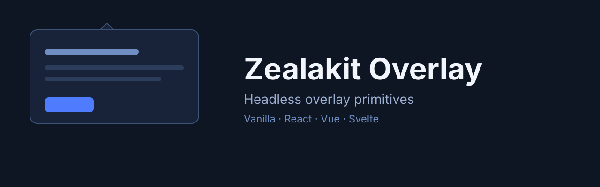

# @zealakit/overlay-vanilla

[English](https://github.com/zealakit/overlay/blob/main/packages/vanilla/README.md) | [Tiếng Việt](https://github.com/zealakit/overlay/blob/main/packages/vanilla/README_VI.md) | [中文](https://github.com/zealakit/overlay/blob/main/packages/vanilla/README_CN.md)



Popover, Tooltip, Dialog và ContextMenu headless cho TypeScript và JavaScript thuần. Cung cấp markup `data-*` khai báo, controller mệnh lệnh, định vị, layer stack, xử lý focus và ARIA trên các phần tử do bạn sở hữu. Bạn tự quyết định kiểu dáng.

Hãy style trigger và content bằng CSS của bạn và các hook `data-*` bên dưới. Controller bật/tắt `hidden` trên content, nên hãy đặt animation thoát trong `animation` thay vì dựa vào `display: none`.

> **Note**
> Overlay là headless: không kèm CSS và không render markup có kiểu dáng. Popover, Tooltip, Dialog và ContextMenu đã được triển khai. Select, Combobox, DatePicker, DropdownMenu, Menubar và command palette thì chưa.

## Install

```bash
npm install @zealakit/overlay-vanilla
```

Không có peer dependency; `@zealakit/overlay-core` được cài tự động. Chỉ ESM.

## Public API

| Export | Purpose |
| --- | --- |
| `initOverlays(root?)` | Biến markup `[data-overlay]` thành controller; trả về `{ get, refresh, destroy }`. |
| `createPopover(options)` | Panel neo không modal, bật/tắt khi bấm. |
| `createTooltip(options)` | Tooltip hover và focus có độ trễ và `role="tooltip"`. |
| `createDialog(options)` | Dialog modal hoặc không modal, giữ focus và khóa scroll. |
| `createContextMenu(options)` | Menu chuột phải và bàn phím với roving focus và typeahead. |
| `createOverlay(options)` | Popover cấp thấp kích hoạt bằng click trên một reference và một phần tử nổi. |
| `createFloating(options)` | Positioner của core ghi `position`, `left`, `top` và `data-placement`. |
| `createLayerStack(options?)` | Registry layer cho một document: thứ tự, lồng nhau, định tuyến Escape và bên ngoài. |
| `createFocusContainment`, `focusElement`, `focusFirst`, `getFocusableElements`, `isFocusable`, `getActiveElement`, `restoreFocus` | Primitive focus cho overlay tùy biến. |

## Markup

### Quick start

```html
<div data-overlay="popover" data-placement="bottom-start" data-offset="8">
  <button data-trigger type="button">Edit profile</button>
  <div data-content hidden>
    <h2 data-title>Edit profile</h2>
    <p data-description>Update your profile information.</p>
    <button data-close type="button">Close</button>
  </div>
</div>
```

```ts
import { initOverlays } from "@zealakit/overlay-vanilla";

const overlays = initOverlays();

document.addEventListener("overlay-change", (event) => {
  console.log((event as CustomEvent).detail); // { open, reason }
});
```

### Host attributes

| Prop | Type | Default | Description |
| --- | --- | --- | --- |
| `data-overlay` | `"popover" \| "tooltip" \| "dialog" \| "context-menu"` | **required** | Loại overlay mà host tạo ra. |
| `data-placement` | `Placement` | `"bottom-start"` | Tooltip mặc định `top`. Dialog không neo. |
| `data-offset` / `data-align-offset` / `data-padding` | `number` | `0` | Khoảng cách và độ lệch (px). |
| `data-flip` / `data-shift` / `data-auto-update` | `boolean` | `true` | Ghi `false` để tắt. |
| `data-strategy` | `"absolute" \| "fixed"` | automatic | Tự động: `absolute`, hoặc `fixed` cho neo fixed/sticky. |
| `data-dir` | `"ltr" \| "rtl"` | — | Áp dụng cho phần tử content. |
| `data-dismiss-on-escape` / `data-dismiss-on-outside-press` | `boolean` | `true` | Ghi `false` để tắt. |
| `data-portal` | `"inline" \| "#selector"` | `document.body` | `inline` giữ content tại chỗ; selector chọn container. |
| `data-animation` / `data-animation-duration` | `"true" \| "fade" \| "expand"` / `number` | — | Tắt trừ khi được đặt. Thời lượng tính bằng mili giây. |
| `data-arrow-size` | `number` | `8` | Dùng khi content có `[data-arrow]`. |
| `data-delay` / `data-close-delay` / `data-hoverable-content` | `number` / `boolean` | `500` / `100` / `true` | Chỉ Tooltip. |
| `data-modal` / `data-lock-scroll` / `data-trap-focus` | `boolean` | `true` / `modal` / `modal` | Chỉ Dialog. |
| `data-initial-focus` / `data-restore-focus` | `"container" \| "first" \| "none"` / `boolean` | `"container"` khi modal / `true` | Nơi focus rơi vào khi mở, và có quay lại khi đóng không. |
| `data-default-open` / `data-disabled` | `boolean` | `false` | Trạng thái ban đầu và trạng thái vô hiệu. |
| `...` | — | — | Thuộc tính khác giữ nguyên trên host. Host phát `overlay-change` với `{ open, reason }` và, với context menu, `overlay-select` với `{ item, event }`; cả hai đều bubble. |

### Child markers

| Attribute | Where | Purpose |
| --- | --- | --- |
| `[data-trigger]` | Con trực tiếp của host | Phần tử mở overlay. Dùng một phần tử thay thế ẩn khi thiếu. |
| `[data-content]` | Con trực tiếp của host, hoặc bên trong `[data-backdrop]` | Phần tử nổi; hãy đặt `hidden` trong markup. |
| `[data-backdrop]` | Con trực tiếp của host | Wrapper của Dialog. Có thể chứa content, khi đó cả hai được portal và bật/tắt như một khối. |
| `[data-arrow]` | Bên trong content | Phần tử mũi tên cho Popover và Tooltip; được controller định vị. |
| `[data-title]` / `[data-description]` | Bên trong content | Được gán id và nối `aria-labelledby` / `aria-describedby` trên content. |
| `[data-close]` | Bên trong content | Đóng overlay chứa nó khi được bấm. |
| `[data-item]` | Bên trong content của context-menu | Trở thành `role="menuitem"`; thêm `data-disabled` để vô hiệu và `data-keep-open` để giữ mở. |

`initOverlays()` bỏ qua host đã có controller nên gọi hai lần là an toàn. Sau khi thêm hoặc bớt markup hãy gọi `refresh()`; gọi `destroy()` khi trang bị gỡ. `get(idOrElement)` trả về controller của một host.

## Usage

### Quick start

```ts
import { createDialog } from "@zealakit/overlay-vanilla";

const dialog = createDialog({
  trigger: document.querySelector<HTMLElement>("#open")!,
  content: document.querySelector<HTMLElement>("#panel")!,
  onOpenChange: (open, reason) => console.log(open, reason),
});

document.querySelector("#close")?.addEventListener("click", () => dialog.close());
```

### Controller options

| Prop | Type | Default | Description |
| --- | --- | --- | --- |
| `trigger` | `HTMLElement` | **required** | Phần tử neo và kích hoạt overlay. |
| `content` | `HTMLElement` | **required** | Phần tử nổi do bạn sở hữu. Controller bật/tắt `hidden` và `data-state`. |
| `backdrop` | `HTMLElement \| null` | — | Phần tử backdrop của Dialog. |
| `open` | `boolean` | — | Hiển thị được điều khiển; phản ánh state ngoài bằng `setOpen()`. |
| `defaultOpen` | `boolean` | `false` | Hiển thị ban đầu khi không điều khiển. |
| `disabled` | `boolean` | `false` | Đóng overlay và bỏ qua trigger. |
| `onOpenChange` | `(open, reason) => void` | — | Gọi mỗi khi người dùng hoặc code thay đổi. |
| `onSelect` | `(item, event) => void` | — | Chỉ ContextMenu: một item được kích hoạt. |
| `portal` | `Element \| null` | — | Chuyển content (và backdrop) vào đây khi mở. |
| `stack` | `LayerStack` | per-document | Dùng chung một layer stack tường minh. |
| `parentLayer` | `LayerStackHandle \| null` | — | Layer cha cho overlay lồng nhau. |
| `boundaries` | `(Element \| null)[]` | — | Phần tử bổ sung được tính là bên trong. |
| `placement` | `Placement` | `"bottom-start"` | Tooltip mặc định `top`. Dialog không neo. |
| `offset` | `number` | `0` | Khoảng cách trục chính (px). |
| `alignOffset` | `number` | `0` | Độ lệch trục phụ (px). |
| `flip` | `boolean` | `true` | Lật sang phía đối diện khi thiếu chỗ. |
| `shift` | `boolean` | `true` | Dịch theo trục phụ để luôn hiển thị. |
| `padding` | `number` | `0` | Khoảng cách tới biên va chạm. |
| `boundary` | `Element \| "clippingAncestors" \| "viewport"` | `"clippingAncestors"` | Biên va chạm. |
| `strategy` | `"absolute" \| "fixed"` | automatic | Tự động: `absolute`, hoặc `fixed` cho neo fixed/sticky. |
| `autoUpdate` | `boolean` | `true` | Đặt lại vị trí khi scroll, resize và đổi layout. |
| `arrow` | `{ element, size?, padding? } \| null` | — | Chỉ Popover và Tooltip; bạn sở hữu phần tử mũi tên. |
| `animation` | `boolean \| AnimationConfig` | — | Tắt trừ khi truyền `true` hoặc config. |
| `dir` | `"ltr" \| "rtl"` | — | Áp dụng cho phần tử content. |
| `dismissOnEscape` | `boolean` | `true` | Đóng khi nhấn Escape (chỉ layer trên cùng). |
| `dismissOnOutsidePress` | `boolean` | `true` | Đóng khi nhấn chính bên ngoài. |
| `modal` | `boolean` | `true` | Chỉ Dialog: nền inert, giữ focus, khóa scroll. |
| `lockScroll` | `boolean` | `true` | Chỉ Dialog, khi `modal`. |
| `trapFocus` | `boolean` | `modal` | Dialog theo `modal`; Popover mặc định `false`. |
| `initialFocus` | `"container" \| "first" \| Element \| boolean \| null` | — | Dialog: container khi modal. ContextMenu: item đầu. Popover: không. |
| `finalFocus` | `Element \| null` | — | Nơi focus quay về khi đóng; mặc định là trigger. |
| `restoreFocus` | `boolean` | `true` | Khôi phục focus khi đóng. |
| `delay` | `number` | `500` | Chỉ Tooltip: độ trễ mở (ms). |
| `closeDelay` | `number` | `100` | Chỉ Tooltip: độ trễ đóng (ms). |
| `hoverableContent` | `boolean` | `true` | Chỉ Tooltip: giữ mở khi con trỏ ở trên content. |
| `labelledBy` / `describedBy` | `string` | — | Chỉ Dialog: id cho `aria-labelledby` / `aria-describedby`. |
| `toggleOnTriggerClick` | `boolean` | `true` | Popover và Dialog: bật/tắt khi bấm trigger. |
| `...` | — | — | Không chuyển tiếp thuộc tính khác; hãy đặt trên phần tử của bạn. |

| Prop | Type | Default | Description |
| --- | --- | --- | --- |
| `isOpen` | `boolean` | — | Hiển thị hiện tại (chỉ đọc). |
| `contentId` | `string` | — | Id gán cho phần tử content. |
| `open(reason?)` / `close(reason?)` / `toggle(reason?)` | `void` | — | Đổi hiển thị và gọi `onOpenChange`. |
| `openAt(point, reason?)` | `void` | — | ContextMenu: mở tại `{ x, y }`; `null` neo vào trigger. |
| `setOpen(open)` | `void` | — | Phản ánh state điều khiển mà không gọi `onOpenChange`. |
| `setOptions(patch)` | `void` | — | Cập nhật option sau khi tạo. |
| `update()` | `Promise<PositionerResult \| null>` | — | Đo lại; trả `null` khi đang đóng. |
| `subscribe(listener)` | `() => void` | — | Gọi ngay và mỗi khi đổi với `{ isOpen, placement, point }`. |
| `destroy()` | `void` | — | Idempotent; gỡ listener và khôi phục thuộc tính. |

Controller mặc định không điều khiển. Truyền `open` và gọi `setOpen()` khi state của bạn quyết định hiển thị; `onOpenChange` vẫn báo ý định của người dùng.

### Controlled usage

```ts
let open = false;
const popover = createPopover({
  trigger,
  content,
  open,
  onOpenChange: (next) => {
    open = next;
    popover.setOpen(open);
  },
});
```

### Animation configuration

```ts
createPopover({
  trigger,
  content,
  arrow: { element: arrowEl, size: 10, padding: 8 },
  animation: { type: "expand", duration: 220 },
});
```

| Prop | Type | Default | Description |
| --- | --- | --- | --- |
| `enabled` | `boolean` | `true` with a config | Đặt `false` để tắt animation. |
| `type` | `"fade" \| "expand" \| "custom"` | `"fade"` | `expand` mở rộng từ cạnh neo; `custom` được suy ra khi có `custom`. |
| `direction` | `"up" \| "down" \| "left" \| "right" \| "auto"` | `"auto"` | Hướng di chuyển; `auto` theo placement đã được giải quyết. |
| `duration` | `number` | `160` | Mili giây. |
| `delay` | `number` | `0` | Mili giây. |
| `easing` | `string` | `"ease-in-out"` | `ease-in-out`, `linear` hoặc mọi CSS timing function. |
| `custom` | `{ enter, exit } \| keyframes` | — | CSS class hoặc keyframes Web Animations (mảng hoặc hàm). |
| `...` | — | — | Truyền `true` để dùng mặc định. Exit phát lại enter theo chiều ngược; reduced motion chỉ giữ opacity. |

### `createOverlay`

```ts
const overlay = createOverlay({
  reference: trigger,
  floating: panel,
  placement: "bottom-start",
  portal: document.body,
  onOpenChange: (open, reason) => console.log(open, reason),
});
```

| Prop | Type | Default | Description |
| --- | --- | --- | --- |
| `reference` | `Element` | **required** | Phần tử neo; bấm vào sẽ bật/tắt khi `trigger` là `"click"`. |
| `floating` | `HTMLElement` | **required** | Phần tử cần định vị. Bị ẩn khi đóng. |
| `trigger` | `"click" \| "none"` | `"click"` | `none` để code của bạn tự bật/tắt. |
| `placement` / `offset` / `alignOffset` / `flip` / `shift` / `padding` / `boundary` / `strategy` / `autoUpdate` | — | — | Giống option controller ở trên; `placement` mặc định `"bottom"`. |
| `portal` | `Element \| null` | — | Chuyển `floating` vào đây khi mở; trả lại khi đóng. |
| `stack` / `boundaries` / `defaultOpen` / `dismissOnEscape` / `dismissOnOutsidePress` | — | — | Giống option controller ở trên. |
| `onOpenChange` | `(open, reason?) => void` | — | `reason` là lý do đóng như `"escape-key"` hoặc `"reference-press"` khi đóng. |

`createOverlay` trả về `isOpen`, `placement`, `open()`, `close(reason?)`, `toggle()`, `update()`, `subscribe(listener)` và `destroy()`. Nó là lớp bọc mỏng quanh controller popover.

## Lifecycle

- Tạo controller sau khi phần tử tồn tại và chỉ trong trình duyệt; `initOverlays`, `createOverlay` và các controller không làm gì hoặc ném lỗi khi không có DOM.
- Tránh init hai lần: `initOverlays` bỏ qua host đã khởi tạo, còn controller thủ công nên là một cho mỗi trigger và dùng lại bằng `setOptions()`.
- Gọi `destroy()` khi phần tử bị gỡ. Nó idempotent và khôi phục thuộc tính, vị trí portal và focus.
- Các controller dùng chung một layer stack đếm tham chiếu cho mỗi document trừ khi bạn truyền `stack`.

## Styling hooks

| Attribute | Where | Purpose |
| --- | --- | --- |
| `data-state` | Content, trigger | `"open"` hoặc `"closed"`. |
| `data-open` / `data-closed` | Content | Cờ có/không cho CSS selector. |
| `data-side` / `data-align` / `data-placement` | Content | Placement sau khi flip và shift. |
| `data-animating` | Content | `"enter"` hoặc `"exit"` khi animation đang chạy. |
| `--overlay-transform-origin` | Content | Gốc theo cạnh neo cho animation dùng class. |
| `--overlay-arrow-*` | Panel hoặc phần tử cha | Màu nền, độ dày và màu viền của mũi tên. |

```css
.panel {
  --overlay-arrow-background: #121a27;
  --overlay-arrow-border-width: 1px;
  --overlay-arrow-border-color: #3d5478;
}
```

## AI Agent Skill

Coding agent làm việc với package này nạp [overlay skill](https://github.com/zealakit/overlay/blob/main/.agents/skills/overlay/SKILL.md) trước tiên.

## License

MIT © Zealakit
